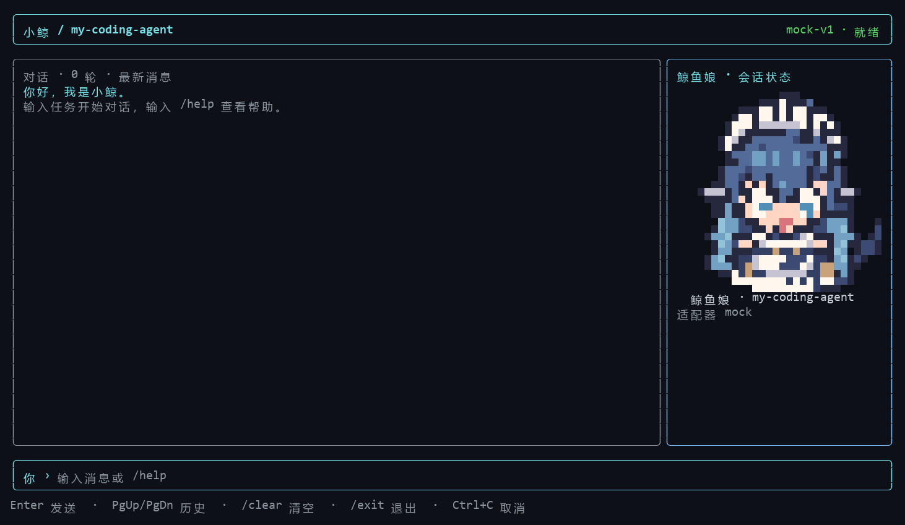

# My Coding Agent

参考 DeepSeek Harness，逐个 PR 开发自己的命令行编码 Agent，并用中文文档解释每一步。

当前提供全屏终端界面，模型可以列出、读取工作区文件，并通过工具循环分析代码。也可使用持续文本对话或单次任务。模型可选择离线模拟或自己的 OpenAI 兼容 API。交互模式支持[文件修改预览与确认](docs/editing.md)，执行命令属于[后续需求](docs/roadmap.md)。

## 启动

需要 Node.js 24.12 或更高版本、pnpm 11.28.5。

```sh
pnpm install --frozen-lockfile
pnpm build
npm link
my-coding-agent --help
my-coding-agent "解释这个项目"
```

预期输出：

```text
[模拟响应，未调用模型 API]
已收到任务：解释这个项目
当前为离线演示；可用“演示读取 文件路径”检查文件工具。
```

```sh
pnpm dev --help
pnpm check
pnpm start "解释这个项目"
```

`npm link` 将本地项目注册为 `my-coding-agent` 命令，之后可以在其他目录运行。终端中不提供任务参数会进入交互会话；`--help` 显示帮助。单次任务也可使用 `pnpm dev "你的任务"`。

`pnpm check` 依次完成类型检查、测试和构建；`pnpm start` 使用已经构建的 `dist/cli.js`。修改源码后需要重新构建，本地命令才会使用最新代码。命令安装说明见[开发文档](docs/development.md#安装命令行入口)。

## 持续对话

配置本地 `.env` 后，在终端运行：

```sh
my-coding-agent --env .env --interactive
```

真实终端中自动进入全屏界面：顶部显示模型和状态，中间显示对话，底部固定输入框，宽屏右侧显示 DeepSeek 蓝鲸字符图标。输入消息后按 Enter 发送，PgUp/PgDn 浏览历史；输入 `/help` 查看帮助、`/clear` 清空上下文、`/exit` 退出。请求期间按 Ctrl+C 取消本次请求，空闲时按 Ctrl+C 退出。成功问答保留在当前进程中；退出后不保存历史。



图标使用本地字符绘制，支持蓝色、无色与小窗口版本，不需要启用终端图片功能。窗口缩小时自动收起侧栏或边框，草稿保持不变。需要逐行输出时加 `--plain`；管道输入自动使用逐行模式。详见[终端图标](docs/mascot.md)、[终端界面](docs/tui.md)和[交互会话](docs/interactive.md)。

## 技术文档

- [架构与 Harness 对照](docs/architecture.md)：各模块的职责和调用过程。
- [开发与配置](docs/development.md)：运行命令、错误处理和适配器扩展方式。
- [逐个 PR 的开发路线](docs/roadmap.md)：各阶段的交付与验收条件。
- [第一份 PR 的说明](docs/prs/001-provider-foundation.md)：本次范围、验证证据和阅读顺序。
- [命令行入口](docs/prs/002-cli-entry.md)：命令安装、帮助行为和交付范围。
- [接入模型 API](docs/model-api.md)：本地配置、请求协议、错误与验证范围。
- [交互会话](docs/interactive.md)：连续输入、上下文、取消与退出。
- [终端界面](docs/tui.md)：布局、按键、中文输入、缩放和纯文本模式。
- [开发日志](docs/development-log.md)：开发问题、根因、解决方案和指标变化。
- [只读 Agent](docs/agent-tools.md)：工作区、工具循环、权限与验证。
- [文件修改与确认](docs/editing.md)：diff、版本检查、应用与拒绝。

## 分析代码

```sh
my-coding-agent --env .env --workspace "D:/你的项目" "读取 README.md，解释项目入口与模块分工"
```

默认工作区为启动命令时的当前目录。单次任务提供只读工具，交互模式另外提供待确认修改；已读取的文本会发送给配置的模型服务；`.env`、私钥、忽略项和符号链接不可读取。`--no-tools` 使用纯文本模式，`--max-steps 12` 设置本轮最多模型请求次数。

离线验证工具循环可运行 `my-coding-agent --provider mock "演示读取 README.md"`。只有模拟模型响应，文件工具会实际读取已授权工作区，工具结果会明确显示。详见[只读 Agent](docs/agent-tools.md)。

## 自己的 API

使用 `openai-compatible` 可连接支持非流式 Chat Completions 的模型服务。按[接入指南](docs/model-api.md)在本地配置地址、模型名和密钥，再运行：

```sh
my-coding-agent --env .env "你的任务"
```

API Key 从本地环境读取，不写入代码、文档或 Git。接口已通过本地模拟 HTTP 服务和 DeepSeek 两轮对话验证。ChatGPT Plus 与普通 API 独立计费，详见[接入指南](docs/model-api.md#费用与订阅)。

项目通过本地链接安装命令，未发布 npm 包。
