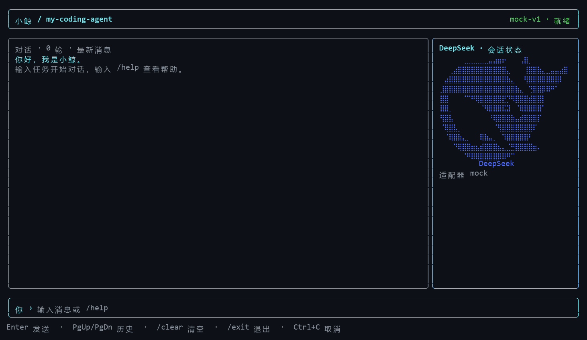

# DeepSeek 蓝鲸终端图标

CLI 使用单色的 DeepSeek 蓝鲸字符图标。全屏界面在宽屏侧栏持续显示，普通窗口在欢迎页显示，紧凑窗口隐藏；逐行模式在启动时显示一次。图标不加入模型消息，不产生模型请求。



预览根据真实伪终端输出的字符、颜色和坐标绘制，字体可能与用户终端不同。

## 查看

```sh
my-coding-agent --provider mock --interactive
```

无需 API Key；自己的模型配置可使用 `my-coding-agent --env .env`。加 `--plain` 查看逐行模式的启动图标。

## 显示规则

彩色终端使用 28 列、11 行的单色 Braille 轮廓，下一行显示 DeepSeek 名称。真彩色使用蓝色 RGB `(77, 107, 254)`，256 色终端使用相近蓝色。渲染结束后重置颜色，避免影响后续对话。

无色或空间不足时使用简化 ASCII 轮廓；更小的窗口仅显示名称。`NO_COLOR` 和非终端输出不包含图标颜色控制符。全屏界面的图标只使用普通文本与颜色，无需终端图片协议；单次任务输出不增加图标。

如果字体不支持 Braille 字符而显示方框，可设置 `NO_COLOR` 后重新启动，使用 ASCII 版本。例如 PowerShell 中运行 `$env:NO_COLOR='1'`，然后启动 CLI。

## 实现与验证

[字符轮廓](../src/mascot-art.ts)参考 DeepSeek Harness 的蓝鲸图形，[渲染函数](../src/mascot.ts)选择颜色与尺寸版本，[逐行交互](../src/interactive.ts)和[全屏视图](../src/tui-view.ts)负责显示。参考来源与许可文本保存在[第三方素材说明](../THIRD_PARTY_NOTICES.md)。图标本身不引入运行依赖。

已通过组件检查、真实伪终端启动与缩放、无色逐行输出和单次输出检查。具体尺寸与字节数见[开发日志](development-log.md)。历史阶段的鲸鱼娘形象记录见[阶段 005](prs/005-whale-mascot.md)。
