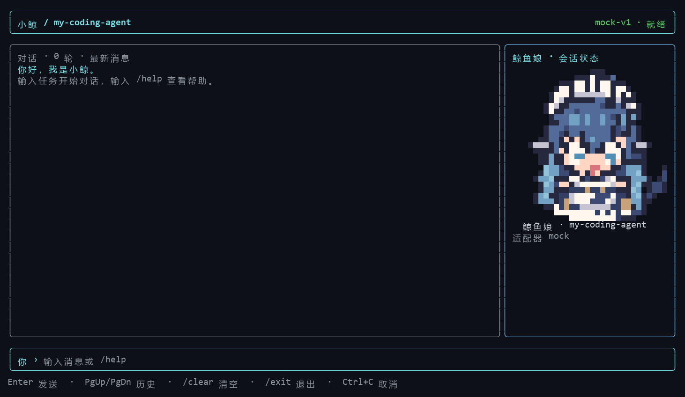

# 全屏终端界面

在终端运行 `my-coding-agent --env .env` 即可进入界面。不需要浏览器或额外服务；配置方式与单次 CLI 调用一致。离线查看使用 `my-coding-agent --provider mock --model mock-v1`。



预览来自真实伪终端运行构建产物后，由终端模拟器的字符、颜色和坐标绘制。字体和背景可能与用户终端不同，预览不是原生终端截图。

## 布局与窗口尺寸

顶部显示模型和请求状态，中间显示对话，底部固定输入框和快捷键说明。成功问答轮数与模型上下文一致，失败输入和提示只出现在显示记录中。

工具执行后，消息区显示工具名与结果摘要，例如 `read_file：读取 src/app.ts，30 行`；读取正文和模型推理不会作为工具提示显示。文件提案显示具体 diff 与 `/apply 编号`、`/reject 编号`，规则见[修改与确认](editing.md)。宽屏侧栏显示当前工作区名称。完整工具结果仍进入模型请求，最终回答由模型生成。

宽度至少 100 列且高度至少 26 行时显示 DeepSeek 蓝鲸图标侧栏。宽度不足 64 列或高度不足 18 行时收起边框，优先保留输入区。其他尺寸使用带边框的单栏对话。缩放不清空草稿或上下文；建议至少 40 列、12 行。

图标使用蓝色的 Unicode 字符绘制，无色环境使用简化 ASCII 轮廓；无需图片协议。若终端字体缺少 Braille 字符，可设置 `NO_COLOR` 使用 ASCII 版本。参考来源与显示规则见[终端图标](mascot.md)。

消息按终端列宽折行，中文和 emoji 按显示宽度计算。只绘制当前消息视口，PgUp/PgDn 浏览此前内容；新消息到达后回到最新消息。当前以纯文本显示完整回复，没有流式输出或 Markdown 高亮。

## 输入与按键

| 按键或命令 | 行为 |
| --- | --- |
| Enter | 发送当前文本 |
| ←、→、Home、End | 在单行草稿中移动光标 |
| Backspace、Delete | 按 Unicode 字素删除前一个或后一个字符 |
| PgUp、PgDn | 浏览本次会话的显示记录 |
| `/help` | 显示命令说明 |
| `/clear` | 清空显示记录、上下文和待确认提案 |
| `/apply 编号`、`/reject 编号` | 确认应用或拒绝修改预览 |
| `/exit` | 退出界面并恢复原终端屏幕 |
| 请求期间 Ctrl+C 或 Esc | 取消当前请求，保留此前成功上下文 |
| 空闲时 Ctrl+C；取消后再次 Ctrl+C | 退出界面 |

输入使用真实终端光标，为中文输入法提供候选位置；候选窗外观由终端和输入法负责，未自动验证本机输入法候选窗。长输入水平滚动，`‹`、`›` 表示两侧还有文本。粘贴的换行和制表符转为空格；当前输入框为单行。请求期间暂停编辑和发送，可取消请求后继续输入。

界面退出后，本次显示记录和上下文均不保存。持久化日志按[开发路线](roadmap.md)另行实现。

## 逐行模式

```sh
my-coding-agent --env .env --plain
```

`--plain` 使用 readline 逐行显示，适合不支持全屏控制的终端。管道或重定向输出自动使用逐行模式，脚本仍需显式指定 `--interactive`。设置 `NO_COLOR` 关闭颜色；它不会关闭全屏界面的光标控制。单次任务输出不进入全屏界面。

全屏终端可能把鼠标滚轮留给终端自身，消息浏览使用 PgUp/PgDn；鼠标选择和复制方式依终端而定。若要保留可直接滚动的输出记录，使用逐行模式。

## 实现与验证

Ink 与 React 管理布局、键盘事件和备用屏幕，wrap-ansi 与 string-width 处理列宽，`Intl.Segmenter` 处理输入字素。TUI 只在输入与输出都是真实终端且未指定 `--plain` 时加载。会话和 provider 沿用原实现。

组件测试覆盖布局、中文与组合字符编辑、缩放、翻页、失败恢复、取消和卸载。`pnpm test:tui:pty` 对构建产物执行真实伪终端检查；`--live` 单独验证本地模型 API。命令、指标与环境问题见[开发文档](development.md#验证范围)和[开发日志](development-log.md)。
